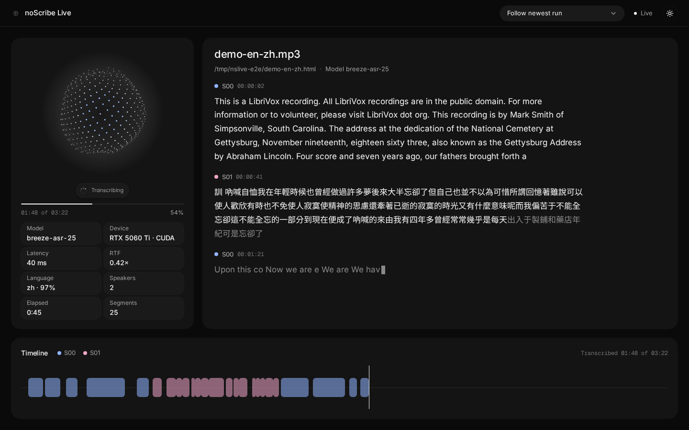

# noScribe Live

noScribe Live is a localhost viewer that shows a noScribe CLI transcription streaming in real time. The page does not start transcriptions. It watches runs of the noScribe CLI started with `--live-feed`, and shows each transcript as it streams in. If you open it mid-run, it catches up from a snapshot.



Paths below are relative to the repo root unless noted.

## Run the viewer

```sh
live/run.sh              # serves http://localhost:8765
live/run.sh --rebuild    # also rebuilds the frontend in live/web
```

`run.sh` creates `live/.venv` (with `uv` for Python 3.11, otherwise `python3 -m venv`), installs `live/requirements.txt` when it changes, and builds `live/web` with pnpm (npm if pnpm is missing) when `live/web/dist` is missing or `--rebuild` is given. Without a build, the server shows a placeholder page. Environment variables:

- `PORT`: port to serve on (default `8765`).
- `SKIP_WEB_BUILD=1`: never run pnpm or npm; serve whatever is in `live/web/dist`.
- `NOSCRIBE_PY`: Python with noScribe installed. It only changes the command that `run.sh` prints.

## Transcribe alongside it

From the repo root, in another terminal:

```sh
PYTHONDONTWRITEBYTECODE=1 /home/cheng/noScribe/venv/bin/python -m noScribe --no-gui --model breeze-asr-25 --speaker-detection auto --timestamps --live-feed live/feeds/ INPUT OUTPUT.html
```

- Any Python environment with noScribe's requirements works. In this container the read-only host venv `/home/cheng/noScribe/venv` is reused; `PYTHONDONTWRITEBYTECODE=1` keeps it untouched.
- Models are found in `~/.config/noScribe/whisper_models`. Link the host models there:

  ```sh
  mkdir -p ~/.config/noScribe/whisper_models
  for m in breeze-asr-25 breeze-asr-26 precise; do ln -sfn /mnt/data/noScribe-models/$m ~/.config/noScribe/whisper_models/$m; done
  ```

- `--live-feed DIR/` writes one `<run_id>.ndjson` per job. You can set `NOSCRIBE_LIVE_FEED` instead of the flag. Without either, noScribe behaves exactly as before. The event format is in [FEED.md](FEED.md).
- The GPU is shared. Check `nvidia-smi` and run one job at a time.

## Demo clip

`live/samples/make-demo-clip.sh` downloads two public-domain LibriVox recordings and builds `live/samples/demo-en-zh.mp3` (3:22, two speakers alternating):

- EN: Abraham Lincoln, "Gettysburg Address" (English)
- ZH: Lu Xun, 呐喊 自序 (preface to "Call to Arms"), read in Mandarin

The script needs `curl`, `ffmpeg`, `ffprobe` and `awk`.

## Rehearse without a GPU

```sh
cd live && .venv/bin/python -m server.replay path/to/recorded.ndjson --feeds feeds --speed 1
```

This replays a recorded feed as a new live run. `--max-gap` caps long pauses (default 5 s).

## Measured on this machine

Real run, 2026-10-20 ([`docs/e2e-arrivals.tsv`](docs/e2e-arrivals.tsv)). breeze-asr-25 on an NVIDIA GeForce RTX 5060 Ti (CUDA, compute_type `default`, float16), 202.4 s bilingual clip:

- Wall time 50.2 s, RTF 0.25 (real-time factor: processing time over audio length). This includes a 20 s model load and about 15 s of diarization.
- Whisper alone (model ready to end): RTF 0.07.
- All 50 segments reached the browser while the CLI was running. The last arrival came 0.7 s before the CLI process exited.
- CLI to browser latency per segment: median 36 ms, p95 70 ms, max 77 ms. Latency is the browser receive time minus the `t` the CLI wrote into the feed line (same machine clock). The file-to-server tail has a median of 30 ms, mostly the 50 ms poll; server-to-browser push has a median of 6 ms.

faster-whisper yields segments per 30 s decoding window, so they arrive in bursts about every 1-2 s. The UI smooths the bursts with a streaming reveal.

## Screenshots

- `docs/01-waiting.png`: before a run
- `docs/02-diarizing.png`: diarizing
- `docs/03-loading-model.png`: loading the model (thinking state)
- `docs/04-midstream.png`, `docs/05-midstream-later.png`, `docs/06-mobile-midstream.png`: mid-run, run 1 (desktop, later, and mobile)
- `docs/04b-midstream-run2.png`, `docs/05b-midstream-later-run2.png`, `docs/06b-mobile-midstream-run2.png`: the same views for run 2
- `docs/07-finished.png`: after the run finished
- `docs/08-reopened-after-run-light.png`: opened after the run, catching up from the snapshot (light theme)

## How it works

- `noScribe/live_feed.py`: opt-in NDJSON writer. The format is documented in [FEED.md](FEED.md).
- `live/server`: FastAPI. It tails `live/feeds`. `GET /api/stream` is server-sent events with `hello` (server time and run list), `snapshot` (catch-up for a run) and `feed` (one event). It also serves `GET /api/runs` and `GET /api/runs/{id}/peaks`.
- `live/web`: React, Vite, TypeScript, Tailwind v4, shadcn/ui and motion.

## UI components and licensing

- From the AICSS free MIT registry, installed unmodified with `pnpm dlx shadcn@latest add https://www.aicss.dev/r/orbs.json https://www.aicss.dev/r/streaming-text.json https://www.aicss.dev/r/thinking-state.json` into `live/web/src/components/aicss/`:
  - `Orb` is used as the status pills and the brand glyph.
  - `ThinkingState` is the thinking label.
  - `StreamingText` is adapted into `streaming-text-inline.tsx`.
- No AICSS Pro components are used.
- Built here: the canvas activity orb (`live/web/src/lib/orb-renderer.ts`), the timeline, the layout and the status chips.

## Tests

```sh
uvx --with pytest pytest tests/test_live_feed.py --noconftest -q                          # hook, from the repo root
cd live && .venv/bin/pip install -r requirements-dev.txt && .venv/bin/python -m pytest    # backend
```

## Known gaps

- The waveform timeline draws segment bars only. Peaks are served by `/api/runs/{id}/peaks` but not drawn yet.
- Speaker labels are raw `S00` and `S01`.
- There are no automated frontend tests.
